<p align="center">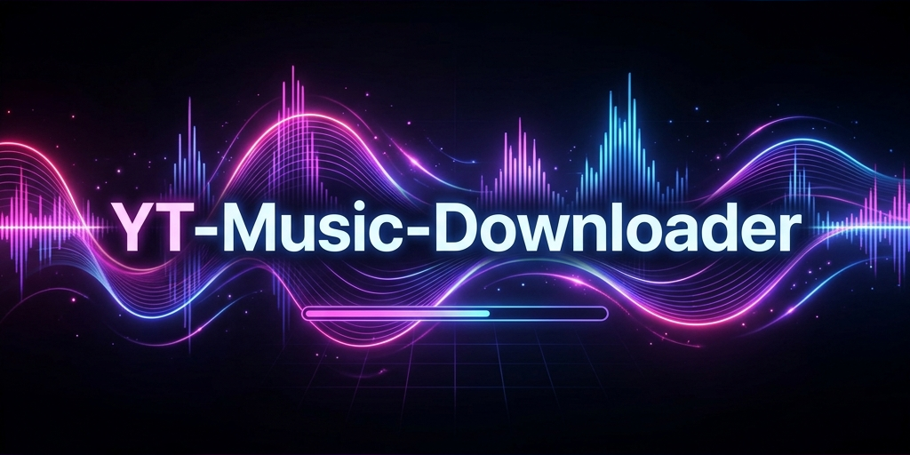</p>

<p align="center">
  <b>Your YouTube Music playlists, mirrored to a folder on your disk — automatically, all the time.</b><br>
  A small self-hosted app with a web UI. Runs in Docker on anything from a Mac mini to a Raspberry Pi.
</p>

<p align="center">
  <a href="https://github.com/RafalPolawski/YT-Music-Downloader/actions/workflows/ci.yml"></a>
  <a href="https://github.com/RafalPolawski/YT-Music-Downloader/pkgs/container/yt-music-downloader"></a>
  <a href="https://github.com/RafalPolawski/YT-Music-Downloader/releases/latest"></a>
  <a href="LICENSE"></a>
</p>

<p align="center">
  <a href="#quick-start">Quick start</a> ·
  <a href="#a-quick-tour">Tour</a> ·
  <a href="#jellyfin--symfonium">Jellyfin &amp; Symfonium</a> ·
  <a href="#configuration">Configuration</a> ·
  <a href="#faq">FAQ</a> ·
  <a href="README.pl.md">🇵🇱 Polska wersja</a>
</p>

---

**YT-Music-Downloader** watches your YouTube Music library and keeps a local copy of every playlist you
choose: new tracks get downloaded, removed tracks get removed (via a trash folder), and the track order of
every playlist is written to an `.m3u8` file. Point Jellyfin, Navidrome or any other music server at the
folder and your playlists show up there — and in apps like **Symfonium** — exactly as they are on
YouTube Music.

YouTube Music is the **source of truth**. You curate playlists where you always do; this app makes sure the
files on your disk follow.

<p align="center">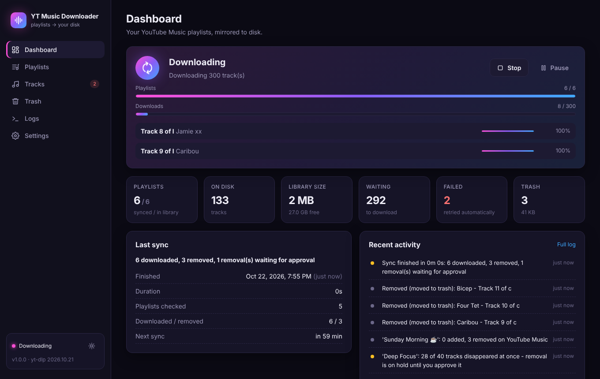</p>

## Highlights

<table>
  <tr>
    <td width="33%" valign="top">
      <h3>🔄 Set and forget</h3>
      Checks YouTube Music every hour and applies additions, removals and re-ordering. New playlists
      start syncing on their own.
    </td>
    <td width="33%" valign="top">
      <h3>📃 Same order everywhere</h3>
      One <code>.m3u8</code> per playlist in the exact YouTube Music order, with relative paths — imported
      by Jellyfin, Navidrome, Symfonium, VLC, foobar2000…
    </td>
    <td width="33%" valign="top">
      <h3>🗂️ Playlists as folders</h3>
      <code>Road Trip/Digital Love.opus</code>, just like on YouTube Music. A song in several playlists is
      stored once and hard-linked. Prefer <code>Artist/Album</code>? One click.
    </td>
  </tr>
  <tr>
    <td valign="top">
      <h3>🎧 Original quality</h3>
      Opus or M4A straight from YouTube, no re-encoding. Album versions instead of music videos, proper tags,
      embedded covers and synced lyrics.
    </td>
    <td valign="top">
      <h3>🛡️ Nothing gets lost</h3>
      Removed tracks wait 30 days in a trash and come back instantly if you re-add them. Suspicious mass
      removals wait for your approval.
    </td>
    <td valign="top">
      <h3>🐳 Runs anywhere</h3>
      One Docker container for amd64 and arm64 (Apple Silicon, Raspberry Pi). yt-dlp keeps itself up to
      date; interrupted runs resume.
    </td>
  </tr>
</table>

## Quick start

You need [Docker](https://docs.docker.com/get-docker/) (Docker Desktop or [OrbStack](https://orbstack.dev) on macOS).

**1. Start the container**

```bash
mkdir yt-music && cd yt-music
curl -O https://raw.githubusercontent.com/RafalPolawski/YT-Music-Downloader/main/docker-compose.yml
# set the folder your music should go to: the left side of ":/music" in docker-compose.yml
docker compose up -d
```

**2. Open http://localhost:8080** (or `http://<server-ip>:8080` from another device) and connect your
YouTube Music account in **Settings** — the steps are shown right there and [explained below](#connecting-your-account).

**3. Pick your playlists.** All playlists are enabled by default (except *Liked Music*, which is usually
huge — enable it if you want it). The first sync starts 5 minutes after connecting, or immediately when you
press **Sync now**.

**4. Point your music server at the folder** — see [Jellyfin & Symfonium](#jellyfin--symfonium).

<details>
<summary>Prefer to build the image yourself?</summary>

```bash
git clone https://github.com/RafalPolawski/YT-Music-Downloader.git
cd YT-Music-Downloader
# in docker-compose.yml: comment out "image:" and uncomment "build: ."
docker compose up -d --build
```
</details>

## A quick tour

### Dashboard

The screenshot at the top: live progress of the current sync with every download in flight, library stats
and a feed of what changed — added, removed, restored, failed. **Stop** cancels the current run; **Pause**
also holds the automatic schedule until you resume (*Sync now* still works).

### Playlists

Every playlist in your library — your own and saved ones — with a switch to mirror it or not. The progress
bar shows how much of it is already on disk; the filters find playlists that need attention.

<p align="center">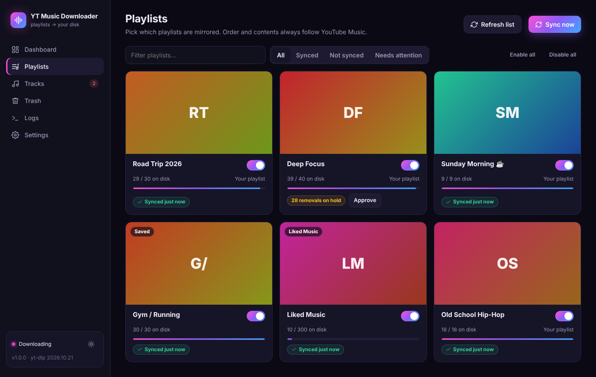</p>

### Tracks

Search everything that is synced, filter by status or playlist, see why a download failed and retry it.
Failed downloads are also retried automatically, with growing pauses. Every playlist name is a link that
opens the song inside that playlist on YouTube Music.

<p align="center">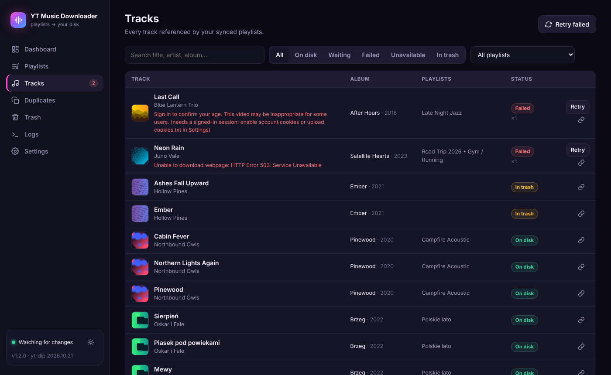</p>

### Cleanup

Two lists of playlist entries worth removing on YouTube Music:

- **Unavailable** — songs YouTube no longer serves: deleted, made private, blocked in your country or
  greyed out. They can't be downloaded, so they only clutter the playlist.
- **Duplicates** — songs that are in the same playlist twice: the same video added again, or the music
  video next to the album version. The app suggests which one to keep, but you can remove any entry.

Remove them one by one or all at once with a click (your own playlists and Liked Music), or open the
entry on YouTube Music and remove it there. Nothing is ever removed automatically, and the local files
follow at the next sync.

<p align="center">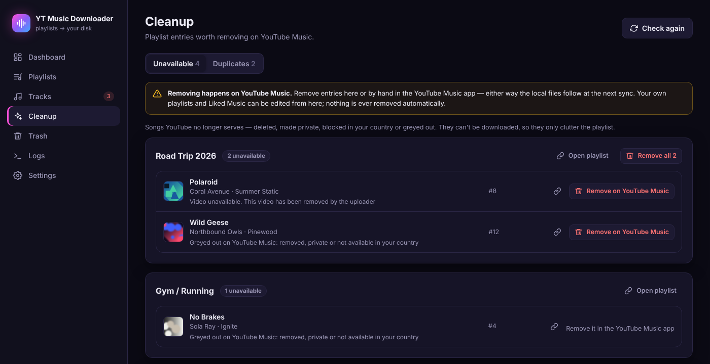</p>
<p align="center">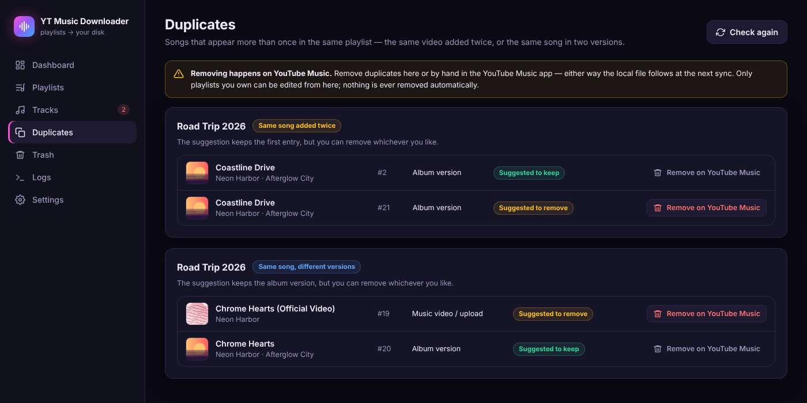</p>

### Trash

Tracks you remove on YouTube Music land in a hidden trash folder first and are deleted after 30 days.
Changed your mind? Add the song back on YouTube Music and the next sync restores it — no download needed.
Each entry links to the song on YouTube Music.

<p align="center">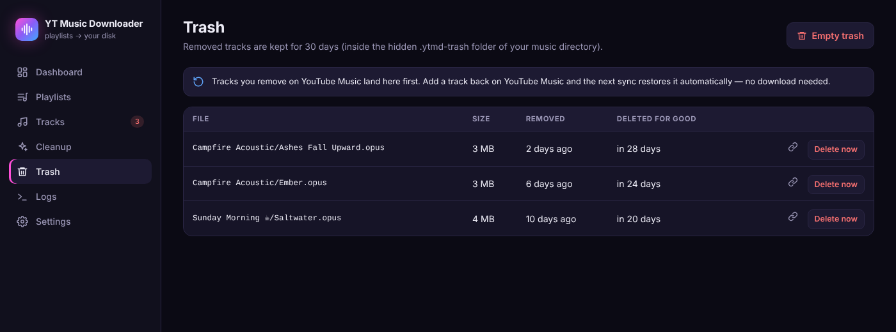</p>

### Library layout

By default the folder mirrors YouTube Music: one folder per playlist. Switch to the classic
`Artist/Album/01 Title` library (best for album and artist views in Jellyfin, Navidrome or Plex),
`Artist/Title` or one flat folder — saving reorganizes the existing files right away, nothing is downloaded
again.

<p align="center">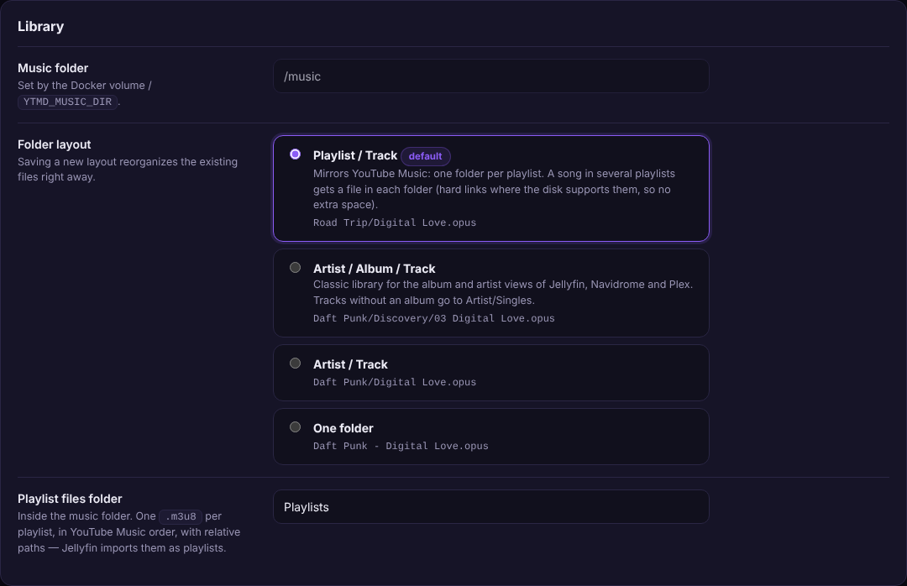</p>

### On your phone, dark or light

The whole UI works on a phone, so you can check on things from the couch. Dark and light themes follow your
system, or the toggle in the sidebar.

<p align="center">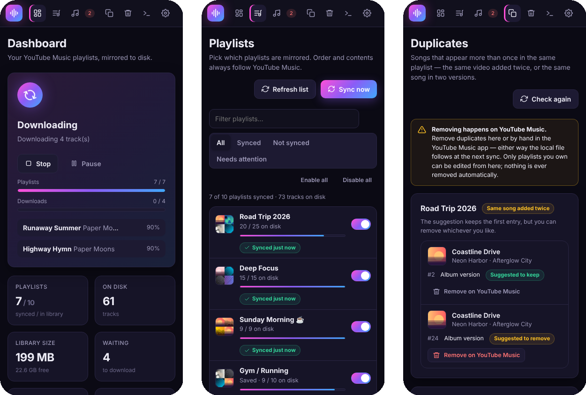</p>
<p align="center">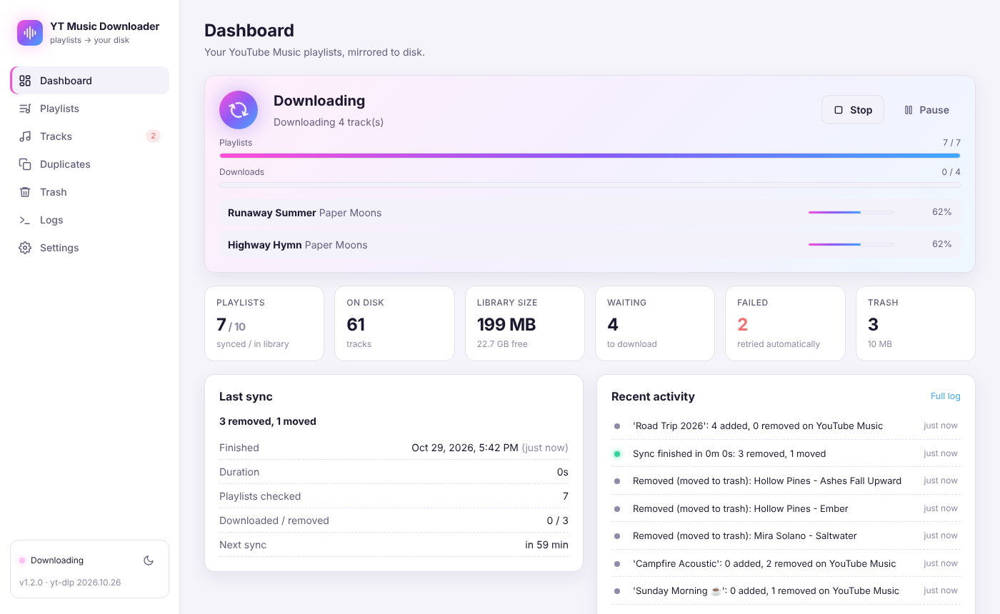</p>

## Connecting your account

Go to **Settings → Connect YouTube Music** and follow the steps shown there:

1. Open [music.youtube.com](https://music.youtube.com) in a desktop browser and sign in.
   *Tip: use a private window and simply close it afterwards — logging out would invalidate the copied session.*
2. Open developer tools (`F12` / `⌥⌘I`) → **Network** tab → type `browse` in the filter.
3. Click **Library** in YouTube Music so a `browse` request (POST) appears.
4. Right-click it → **Copy → Copy request headers** (Firefox: *Copy Request Headers*; *Copy as cURL* also works).
5. Paste into the box and click **Connect**.

<p align="center">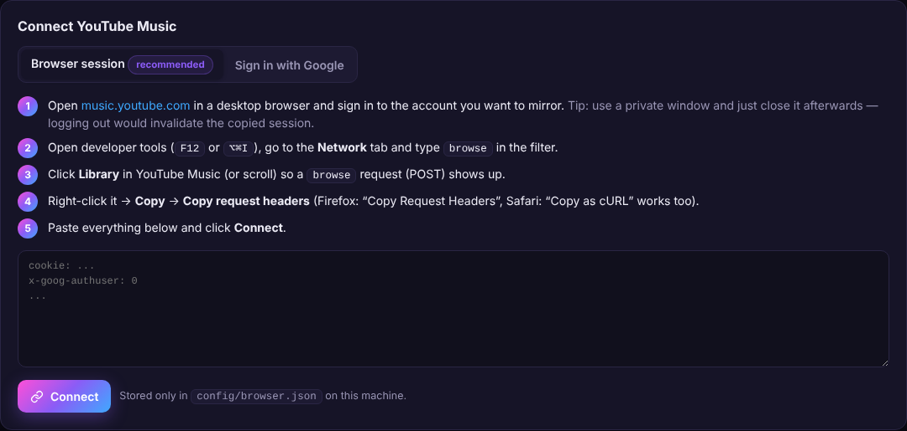</p>

The session stays valid for a long time (typically months to years) as long as you don't sign out of it.
If it ever expires, the dashboard tells you and you just paste fresh headers.

> Upgrading from the old script? You can paste the contents of your old `headers.json` instead.

<details>
<summary>Alternative: “Sign in with Google” (OAuth device code)</summary>

The **Sign in with Google** tab works like signing in on a TV: the app shows a code, you confirm it at
[google.com/device](https://www.google.com/device) on any device. Google only allows this with your own
OAuth client, which is a one-time, free setup:

1. In [Google Cloud Console](https://console.cloud.google.com/) create a project and enable **YouTube Data API v3**.
2. **APIs & Services → OAuth consent screen**: user type *External*, add your Google account as a **test user**.
3. **Credentials → Create credentials → OAuth client ID**, type **TVs and Limited Input devices**.
4. Paste the client ID and secret in the app, click **Get sign-in code** and confirm the code.

The browser-session method stays the recommended one: it needs no Google Cloud project, is the most
reliable with YouTube Music, and is required for *Download as signed-in user*.
</details>

## How it works

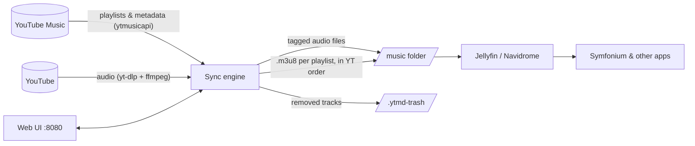

Every sync run:

1. Reads the playlists in your library and the tracks of every playlist you enabled.
2. Moves files that are no longer in **any** synced playlist to the trash, restores files that came back,
   and renames/moves files whose metadata or folder layout changed.
3. Downloads missing tracks, tags them, adds cover art and lyrics.
4. Writes one `.m3u8` per playlist, deletes trash older than the retention period and (optionally) asks
   Jellyfin to rescan.

## What ends up on disk

```text
music/
├── Road Trip/                         ← one folder per playlist (default layout)
│   ├── cover.jpg                      ← generated playlist cover
│   ├── Digital Love.opus
│   ├── Digital Love.lrc               ← synced lyrics (when available)
│   └── Kong.opus
├── Deep Focus/
│   └── Kong.opus                      ← same song in two playlists: hard link, no extra space
├── Playlists/
│   ├── Road Trip.m3u8                 ← track order exactly as on YouTube Music
│   └── Deep Focus.m3u8
├── .ytmd-trash/                       ← hidden: removed tracks, purged after 30 days
└── .ytmd-tmp/                         ← hidden: downloads in progress
```

File names are just the song title; if two different songs in one playlist share a title, the artist is
added (`Kong (Bonobo).opus`). A playlist file looks like this — paths are relative so it works no matter
where the folder is mounted:

```text
#EXTM3U
#PLAYLIST:Road Trip
#EXTINF:301,Daft Punk - Digital Love
../Road Trip/Digital Love.opus
#EXTINF:244,Bonobo - Kong
../Road Trip/Kong.opus
```

Hard links need the music folder on one disk; where they are not supported (some network shares) a normal
copy is made.

## Jellyfin & Symfonium

1. In Jellyfin: **Dashboard → Libraries → Add Media Library**, content type **Music**, folder = your music folder.
   If Jellyfin runs in Docker, mount the same host folder into it (the container path does not matter
   thanks to relative paths in the playlists).
2. Jellyfin imports the `.m3u8` files from `Playlists/` as playlists, in YouTube Music order. They show up
   after a library scan.
3. Jellyfin scans libraries on its own schedule (**Dashboard → Scheduled Tasks → Scan Media Library**,
   add e.g. an hourly trigger if you want changes to appear faster). Optionally, enter your Jellyfin URL and an
   API key in **Settings → Jellyfin** and a scan is triggered right after every sync that changed something.
4. In **Symfonium**, add your Jellyfin server as a media provider. Playlists and new tracks appear after the
   next provider sync.

**Covers in the playlist layout:** Jellyfin treats every folder as one album, so the songs of a playlist
folder share that album's picture — which can look like "wrong" covers on some songs. To make it
intentional, the app puts a generated `cover.jpg` with the playlist name into every playlist folder
(Settings → *Folder covers*):

<p align="center"></p>

The real cover of each song stays embedded in its file; if you want Jellyfin and Symfonium to show per-album
artwork everywhere, use the `Artist/Album/Track` layout.

**Navidrome** works the same way — it imports `.m3u8` playlists from the music folder automatically.

## Running 24/7 on a Mac mini (Apple Silicon)

- Install **OrbStack** (lightweight, recommended) or **Docker Desktop** and enable *start at login*.
  The image is native arm64, no emulation.
- Use an absolute path for the music folder, e.g.
  ```yaml
  volumes:
    - ./config:/config
    - "/Users/you/Music/YouTube Music:/music"
  ```
  External drives live under `/Volumes/...`; with Docker Desktop add them under
  *Settings → Resources → File sharing* (OrbStack shares everything by default).
- `PUID`/`PGID` can stay at the defaults on macOS — files are owned by your user anyway.
- *System Settings → Energy*: enable **Prevent automatic sleeping when the display is off** and
  **Start up automatically after a power failure**.
- `restart: unless-stopped` in the compose file brings the app back after reboots.

On a Linux server set `PUID`/`PGID` to the owner of the music folder (`id -u` / `id -g`).

## Configuration

Almost everything is configured in the web UI and stored in `config/settings.json`.

| Setting | Default | What it does |
| --- | --- | --- |
| Check YouTube Music | every hour | How often playlists are compared with YouTube Music. |
| Sync new playlists automatically | on | New playlists in your library start syncing by themselves. |
| Format | Opus | `opus` / `m4a` (original streams) or `mp3` (re-encoded V0). |
| Prefer album versions | on | Download the album track instead of a music video. |
| Lyrics / folder covers | on | Embedded lyrics + `.lrc`, `cover.jpg` per album or playlist folder. |
| Folder layout | Playlist/Track | Also `Artist/Album/Track`, `Artist/Track` or one flat folder. |
| Playlist files folder | `Playlists` | Where the `.m3u8` files go (inside the music folder). |
| Keep removed tracks for | 30 days | `0` deletes immediately. |
| Safety net | 50 % / 10 tracks | Hold removals when a playlist suddenly loses this much. |
| Parallel downloads / pause | 2 / 3 s | Be gentle — YouTube rate-limits aggressive downloaders. |
| Download as signed-in user | off | Needed for age-restricted tracks and Premium 256 kbps streams. |
| Jellyfin URL + API key | – | Optional: trigger a library scan after each sync. |
| Keep log files for | forever (`0`) | Logs are kept in `config/logs`, one file per day; the setting shows how much space they use. |

Environment variables (container level):

| Variable | Default | Description |
| --- | --- | --- |
| `PUID` / `PGID` | `1000` | User/group the app runs as and owns the files. |
| `TZ` | `Etc/UTC` | Time zone for logs and the UI, e.g. `Europe/Warsaw`. |
| `YTMD_WEB_PASSWORD` | – | Protects the web UI with HTTP basic auth (user `admin`). |
| `YTMD_WEB_USER` | `admin` | User name for the password above. |
| `YTMD_PORT` | `8080` | Port inside the container. |
| `YTMD_MUSIC_DIR` / `YTMD_CONFIG_DIR` | `/music` / `/config` | Paths inside the container. |
| `YTMD_LOG_LEVEL` | `INFO` | `DEBUG` for very verbose logs. |

The `config` folder contains `browser.json` — your YouTube Music session. **Treat it like a password**,
and don't expose port 8080 to the internet (use a VPN such as Tailscale for remote access).

## Removals, trash and safety nets

- Removing a song from a playlist on YouTube Music removes it from that playlist's folder. The downloaded
  file itself goes to the trash only when the song is in no synced playlist any more.
- Removed files go to `.ytmd-trash/` (hidden from media servers) and are deleted after the retention period.
  The **Trash** page lists them; you can delete them right away or empty the trash.
- If a track comes back to a playlist, it is restored from the trash instead of being downloaded again.
- **Disabling** a playlist in the UI removes its `.m3u8` and its exclusive tracks (to the trash).
- **Safety nets:** when a playlist loses ≥ 50 % of its tracks at once (and more than 10), or several
  playlists vanish from the library at the same time, nothing is removed until you click **Approve** —
  this protects you from hiccups on YouTube's side.

## FAQ

**Do I need YouTube Music Premium?**
No, a free account works. With Premium and *Download as signed-in user* enabled, the 256 kbps streams are
used where available.

**Does the app know my Google password?**
No. It keeps the browser session you paste (or an OAuth token) in `config/` on your machine and uses it
only for requests to YouTube.

**Do I need Jellyfin?**
No. The result is a plain folder of tagged audio files plus `.m3u8` playlists — use it with any player or
music server, or copy it to a phone.

**What happens when I rename or delete a playlist on YouTube Music?**
A renamed playlist's folder and `.m3u8` are renamed at the next sync. A deleted playlist disappears from the
folder, and its songs go to the trash unless another synced playlist still has them.

**Will YouTube mind?**
A check is a few light requests per playlist once an hour, and downloads only happen when something
changed. They run two at a time with a pause in between, and the app backs off on its own when YouTube
starts rate-limiting.

## Troubleshooting

| Symptom | Fix |
| --- | --- |
| *“Sign in to confirm you're not a bot”*, HTTP 429 | YouTube is rate-limiting your IP. The app pauses downloads automatically (1 h, then longer) and resumes on its own. Lower *Parallel downloads* or raise the pause. |
| Age-restricted / Premium-only tracks fail | Enable *Download as signed-in user* or upload a `cookies.txt` (Settings → Downloads). |
| “Sign-in expired” on the dashboard | Paste fresh request headers in Settings (you probably signed out of that browser session). |
| Banner “music folder is not writable” | Set `PUID`/`PGID` to the owner of the folder. |
| Track shows *Unavailable* | It is greyed out on YouTube Music (removed or region-locked); it is skipped. Remove it from the playlist on the **Cleanup** page. |
| Many downloads suddenly fail | Usually an outdated yt-dlp; it updates daily, or press *Update now* in Settings → Advanced. |

Logs: the **Logs** page (history survives restarts and updates, older days can be downloaded there),
`docker compose logs -f`, or the daily files in `config/logs/`.

## Updating

```bash
docker compose pull && docker compose up -d
```

Settings, the account connection and the sync state live in `config/`, so updates are safe.
Image tags: `latest` is the newest release, `1` stays on 1.x releases, `1.3.0` pins an exact
version and `edge` follows the `main` branch. What changed in each version is listed in the
[changelog](CHANGELOG.md) and on the [releases page](https://github.com/RafalPolawski/YT-Music-Downloader/releases).

## Running without Docker

Requires Python 3.11+, `ffmpeg` and (recommended) [`deno`](https://deno.com) in `PATH`.

```bash
python -m venv .venv && source .venv/bin/activate
pip install -r requirements.txt
YTMD_CONFIG_DIR=./data/config YTMD_MUSIC_DIR=./data/music python -m ytmd
```

## Development

```bash
pip install -r requirements-dev.txt
python -m pytest
```

| Path | Purpose |
| --- | --- |
| `ytmd/sync.py` | Sync engine: reconcile playlists, trash/restore, downloads, `.m3u8` |
| `ytmd/ytmusic.py` | YouTube Music API wrapper (ytmusicapi) and account connection |
| `ytmd/downloader.py` | yt-dlp subprocess wrapper, progress and error classification |
| `ytmd/tagger.py` | Tags, cover art and lyrics for Opus / M4A / MP3 |
| `ytmd/library.py` | File naming, folder layout, trash, playlist files |
| `ytmd/duplicates.py`, `ytmd/unavailable.py` | Cleanup: duplicates and songs that can't be downloaded |
| `ytmd/covers.py` | Generated playlist covers |
| `ytmd/db.py` | SQLite state |
| `ytmd/scheduler.py`, `ytmd/updater.py` | Periodic runs, yt-dlp self-update |
| `ytmd/logs.py` | Console, daily log files and the in-app log view |
| `ytmd/web/` | FastAPI backend and the single-page web UI (no build step) |
| `tests/` | Pytest suite: fake YouTube Music, scripted and real yt-dlp runs (no network needed) |

**Releasing:** bump `__version__` in `ytmd/__init__.py` and add a section to `CHANGELOG.md`, then
either push a tag `vX.Y.Z` or run the **Release** workflow from the Actions tab with the version
number. GitHub Actions creates the GitHub release from the changelog and publishes the Docker images.

## Disclaimer

This project is meant for personal backups of music you have access to. Respect YouTube's Terms of
Service and copyright law in your country. It is not affiliated with YouTube or Google.
The playlists, artists and artwork in the screenshots are made up.

## License

[MIT](LICENSE)
