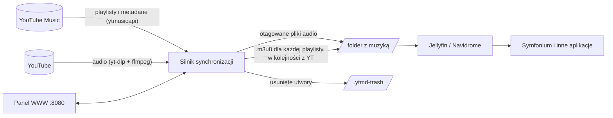
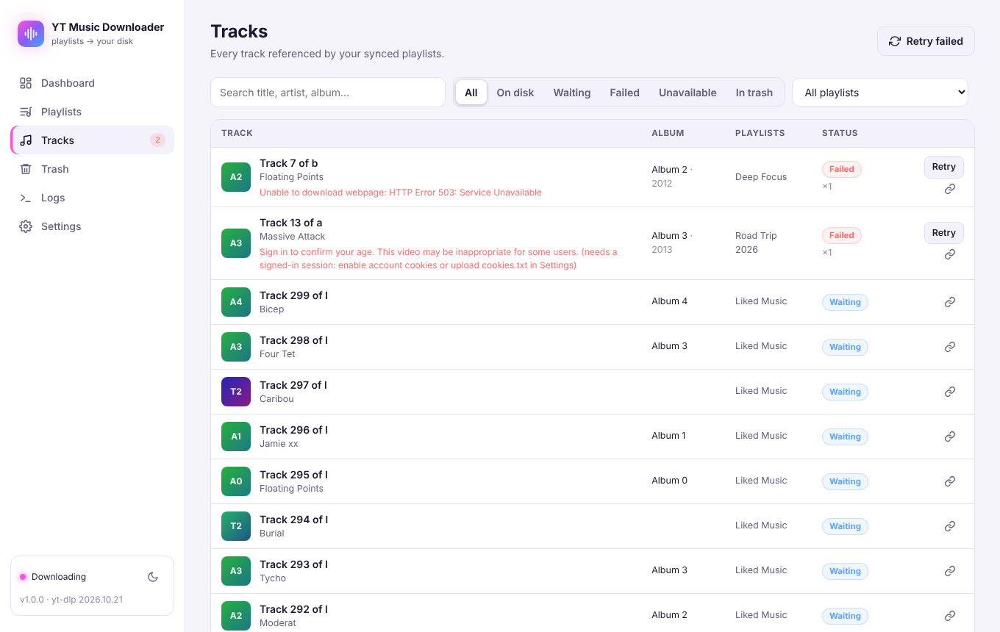

<p align="center"></p>

<p align="center">
  <b>Twoje playlisty z YouTube Music, wiernie odwzorowane w folderze na dysku — automatycznie i na bieżąco.</b><br>
  Mała aplikacja self-hosted z panelem WWW. Działa w Dockerze na wszystkim: od Mac mini po Raspberry Pi.
</p>

<p align="center">
  <a href="https://github.com/RafalPolawski/YT-Music-Downloader/actions/workflows/ci.yml"></a>
  <a href="https://github.com/RafalPolawski/YT-Music-Downloader/pkgs/container/yt-music-downloader"></a>
  <a href="https://github.com/RafalPolawski/YT-Music-Downloader/releases/latest"></a>
  <a href="LICENSE"></a>
</p>

<p align="center"><a href="README.md">🇬🇧 English version</a></p>

---

**YT-Music-Downloader** obserwuje Twoją bibliotekę YouTube Music i trzyma lokalną kopię każdej wybranej
playlisty: nowe utwory są pobierane, usunięte — usuwane (przez kosz), a kolejność utworów każdej playlisty
trafia do pliku `.m3u8`. Wystarczy wskazać ten folder w Jellyfinie, Navidrome lub innym serwerze muzyki,
a playlisty pojawią się tam — i w aplikacjach typu **Symfonium** — dokładnie takie, jak w YouTube Music.

**YouTube Music jest źródłem prawdy.** Playlisty układasz tam, gdzie zawsze, a aplikacja pilnuje, żeby
pliki na dysku za tym nadążały.


## Możliwości

- 🔄 **Ciągła synchronizacja** – sprawdza YouTube Music cyklicznie (domyślnie co godzinę) i przenosi
  dodania, usunięcia oraz zmiany kolejności.
- 📃 **Playlisty jako `.m3u8`** w dokładnie tej samej kolejności co w YouTube Music, ze ścieżkami
  względnymi — działają w Jellyfinie, Navidrome, Symfonium (przez serwer), foobar2000, VLC…
- 🗂️ **Porządna biblioteka, a nie kupka plików** – każdy utwór zapisany raz (nawet jeśli jest w dziesięciu
  playlistach) jako `Wykonawca/Album/01 Tytuł.opus`, z tagami: wykonawca, wykonawca albumu, album, rok,
  numer utworu, okładka w pliku, `cover.jpg` w folderze albumu oraz tekst (zsynchronizowany `.lrc`, jeśli
  jest dostępny).
- 🎬 **Wersje albumowe zamiast teledysków** – jeśli na playliście jest teledysk, pobierana jest czysta wersja
  z albumu (do wyłączenia).
- 🎧 **Najlepsza jakość bez ponownego kodowania** – Opus (domyślnie) lub M4A to oryginalne strumienie
  z YouTube; MP3 dla starszych urządzeń.
- 🗑️ **Kosz z automatycznym przywracaniem** – usunięte utwory czekają 30 dni (do ustawienia) w ukrytym
  folderze. Dodasz piosenkę z powrotem w YouTube Music — wraca od razu, bez ponownego pobierania.
- 🛡️ **Bezpieczniki** – jeśli YouTube nagle zwróci w połowie pustą playlistę albo „zgubi” bibliotekę,
  nic nie zostanie usunięte, dopóki tego nie zatwierdzisz w panelu.
- 🖥️ **Panel WWW** – dashboard z postępem na żywo, wybór playlist, przeglądarka utworów z ponawianiem,
  kosz, logi i wszystkie ustawienia. Tryb ciemny i jasny, działa też na telefonie.
- 🐳 **Docker, multi-arch** (amd64 / arm64 — Apple Silicon, Raspberry Pi), `PUID`/`PGID`, healthcheck,
  odporny na restarty.
- 🧠 **Odporność** – yt-dlp aktualizuje się codziennie sam, nieudane pobrania są ponawiane z rosnącymi
  odstępami, przy limitowaniu przez YouTube pobieranie samo robi przerwę, a przerwane synchronizacje
  kontynuują od miejsca, w którym stanęły.

## Jak to działa



Każda synchronizacja:

1. Czyta playlisty z Twojej biblioteki i utwory każdej włączonej playlisty.
2. Przenosi do kosza pliki, których nie ma już w **żadnej** synchronizowanej playliście, przywraca te,
   które wróciły, oraz przenosi/zmienia nazwy plików, gdy zmieniły się metadane albo układ folderów.
3. Pobiera brakujące utwory, taguje je, dodaje okładki i teksty.
4. Zapisuje po jednym `.m3u8` na playlistę, czyści z kosza stare pliki i (opcjonalnie) prosi Jellyfina
   o przeskanowanie biblioteki.

## Szybki start

Potrzebujesz [Dockera](https://docs.docker.com/get-docker/) (na macOS: Docker Desktop albo [OrbStack](https://orbstack.dev)).

### 1. Uruchom kontener

```bash
mkdir yt-music && cd yt-music
curl -O https://raw.githubusercontent.com/RafalPolawski/YT-Music-Downloader/main/docker-compose.yml
```

W `docker-compose.yml` ustaw folder, do którego ma trafiać muzyka (lewa strona `:/music`), a potem:

```bash
docker compose up -d
```

Otwórz **http://localhost:8080** (albo `http://<ip-serwera>:8080` z innego urządzenia).

<details>
<summary>Wolisz zbudować obraz samodzielnie?</summary>

```bash
git clone https://github.com/RafalPolawski/YT-Music-Downloader.git
cd YT-Music-Downloader
# w docker-compose.yml: zakomentuj "image:" i odkomentuj "build: ."
docker compose up -d --build
```
</details>

### 2. Połącz konto YouTube Music

Wejdź w **Settings → Connect YouTube Music** i wykonaj pokazane tam kroki:

1. Otwórz [music.youtube.com](https://music.youtube.com) w przeglądarce na komputerze i zaloguj się.
   *Wskazówka: użyj okna prywatnego i po prostu je zamknij — wylogowanie unieważniłoby skopiowaną sesję.*
2. Otwórz narzędzia deweloperskie (`F12` / `⌥⌘I`) → zakładka **Network** → wpisz `browse` w filtrze.
3. Kliknij **Biblioteka** w YouTube Music, żeby pojawiło się żądanie `browse` (POST).
4. Prawy klik → **Copy → Copy request headers** (Firefox: *Copy Request Headers*; działa też *Copy as cURL*).
5. Wklej do pola i kliknij **Connect**.

Sesja pozostaje ważna długo (zwykle miesiące, nawet lata), dopóki się z niej nie wylogujesz. Jeśli
kiedyś wygaśnie, dashboard to pokaże — wtedy wystarczy wkleić świeże nagłówki.

> Przechodzisz ze starej wersji skryptu? Możesz wkleić zawartość starego pliku `headers.json`.

<details>
<summary>Alternatywa: „Sign in with Google” (kod urządzenia OAuth)</summary>

Zakładka **Sign in with Google** działa jak logowanie na telewizorze: aplikacja pokazuje kod, a Ty
potwierdzasz go na [google.com/device](https://www.google.com/device) na dowolnym urządzeniu. Google
pozwala na to tylko z własnym klientem OAuth — to jednorazowa, darmowa konfiguracja:

1. W [Google Cloud Console](https://console.cloud.google.com/) utwórz projekt i włącz **YouTube Data API v3**.
2. **APIs & Services → OAuth consent screen**: typ użytkownika *External*, dodaj swoje konto Google jako **test user**.
3. **Credentials → Create credentials → OAuth client ID**, typ **TVs and Limited Input devices**.
4. Wklej client ID i secret w aplikacji, kliknij **Get sign-in code** i potwierdź kod.

Zalecaną metodą pozostaje sesja z przeglądarki: nie wymaga projektu w Google Cloud, jest najbardziej
niezawodna z YouTube Music i tylko z nią działa *Download as signed-in user*.
</details>

### 3. Wybierz playlisty

Po połączeniu trafisz na stronę **Playlists**. Domyślnie wszystkie playlisty są włączone (poza *Liked
Music*, która zwykle jest ogromna — włącz ją, jeśli chcesz). Pierwsza synchronizacja startuje 5 minut po
połączeniu konta albo od razu po kliknięciu **Sync now**.


<details>
<summary>Przeglądarka utworów (jasny motyw)</summary>


</details>

### 4. Wskaż folder serwerowi muzyki

Zobacz [Jellyfin i Symfonium](#jellyfin-i-symfonium) poniżej.

## Co ląduje na dysku

```text
music/
├── Daft Punk/
│   └── Discovery/
│       ├── 03 Digital Love.opus
│       ├── 03 Digital Love.lrc        ← zsynchronizowany tekst (jeśli jest)
│       └── cover.jpg
├── Bonobo/
│   └── Singles/                       ← utwory bez albumu
│       └── Kong.opus
├── Playlists/
│   ├── Road Trip.m3u8
│   └── Deep Focus.m3u8
├── .ytmd-trash/                       ← ukryty: usunięte utwory, kasowane po 30 dniach
└── .ytmd-tmp/                         ← ukryty: pobierania w toku
```

Plik playlisty wygląda tak — kolejność jest taka jak w YouTube Music, a ścieżki są względne, więc działa
niezależnie od tego, gdzie folder jest zamontowany:

```text
#EXTM3U
#PLAYLIST:Road Trip
#EXTINF:301,Daft Punk - Digital Love
../Daft Punk/Discovery/03 Digital Love.opus
#EXTINF:244,Bonobo - Kong
../Bonobo/Singles/Kong.opus
```

Układ folderów można zmienić w ustawieniach (`Wykonawca/Album/Utwór`, `Wykonawca/Utwór` albo jeden płaski
folder) — istniejące pliki zostaną automatycznie przeniesione.

## Jellyfin i Symfonium

1. W Jellyfinie: **Dashboard → Libraries → Add Media Library**, typ zawartości **Music**, folder = Twój
   folder z muzyką. Jeśli Jellyfin działa w Dockerze, zamontuj do niego ten sam folder z hosta (ścieżka
   w kontenerze nie ma znaczenia dzięki ścieżkom względnym w playlistach).
2. Jellyfin importuje pliki `.m3u8` z folderu `Playlists/` jako playlisty, w kolejności z YouTube Music.
   Pojawiają się po skanowaniu biblioteki.
3. Jellyfin skanuje biblioteki według własnego harmonogramu (**Dashboard → Scheduled Tasks → Scan Media
   Library** — dodaj np. wyzwalacz co godzinę, jeśli zmiany mają pojawiać się szybciej). Opcjonalnie wpisz
   adres Jellyfina i klucz API w **Settings → Jellyfin** — wtedy skan uruchomi się zaraz po każdej
   synchronizacji, która coś zmieniła.
4. W **Symfonium** dodaj serwer Jellyfin jako źródło (media provider). Playlisty i nowe utwory pojawią się
   po kolejnej synchronizacji źródła.

**Navidrome** działa tak samo — automatycznie importuje playlisty `.m3u8` z folderu z muzyką.

## Mac mini (Apple Silicon) 24/7

- Zainstaluj **OrbStack** (lekki, polecany) albo **Docker Desktop** i włącz *uruchamianie przy logowaniu*.
  Obraz jest natywnie arm64, bez emulacji.
- Podaj pełną ścieżkę do folderu z muzyką, np.
  ```yaml
  volumes:
    - ./config:/config
    - "/Users/ty/Music/YouTube Music:/music"
  ```
  Dyski zewnętrzne są pod `/Volumes/...`; w Docker Desktop dodaj je w *Settings → Resources → File
  sharing* (OrbStack udostępnia wszystko domyślnie).
- `PUID`/`PGID` na macOS mogą zostać domyślne — pliki i tak należą do Twojego użytkownika.
- *Ustawienia systemowe → Energia*: włącz **Zapobiegaj automatycznemu usypianiu, gdy ekran jest
  wyłączony** oraz **Uruchamiaj automatycznie po awarii zasilania**.
- `restart: unless-stopped` w pliku compose podnosi aplikację po restarcie komputera.

Na serwerze z Linuksem ustaw `PUID`/`PGID` na właściciela folderu z muzyką (`id -u` / `id -g`).

## Konfiguracja

Prawie wszystko ustawia się w panelu WWW; zapisuje się to w `config/settings.json`.

| Ustawienie | Domyślnie | Co robi |
| --- | --- | --- |
| Check YouTube Music | co godzinę | Jak często playlisty są porównywane z YouTube Music. |
| Sync new playlists automatically | wł. | Nowe playlisty w bibliotece same zaczynają się synchronizować. |
| Format | Opus | `opus` / `m4a` (oryginalne strumienie) lub `mp3` (przekodowane V0). |
| Prefer album versions | wł. | Pobiera utwór z albumu zamiast teledysku. |
| Lyrics / Album folder covers | wł. | Tekst w pliku + `.lrc`, `cover.jpg` w folderze albumu. |
| Folder layout | Artist/Album/Track | Albo `Artist/Track`, albo jeden płaski folder. |
| Playlist files folder | `Playlists` | Gdzie trafiają pliki `.m3u8` (wewnątrz folderu z muzyką). |
| Keep removed tracks for | 30 dni | `0` = usuwanie od razu. |
| Safety net | 50 % / 10 utworów | Wstrzymuje usuwanie, gdy playlista nagle tyle straci. |
| Parallel downloads / pause | 2 / 3 s | Delikatnie — YouTube limituje agresywne pobieranie. |
| Download as signed-in user | wył. | Potrzebne dla utworów 18+ i strumieni Premium 256 kb/s. |
| Jellyfin URL + API key | – | Opcjonalnie: skan biblioteki po każdej synchronizacji. |

Zmienne środowiskowe (poziom kontenera):

| Zmienna | Domyślnie | Opis |
| --- | --- | --- |
| `PUID` / `PGID` | `1000` | Użytkownik/grupa, jako które działa aplikacja i do których należą pliki. |
| `TZ` | `Etc/UTC` | Strefa czasowa logów i panelu, np. `Europe/Warsaw`. |
| `YTMD_WEB_PASSWORD` | – | Zabezpiecza panel hasłem (HTTP basic auth, użytkownik `admin`). |
| `YTMD_WEB_USER` | `admin` | Nazwa użytkownika do hasła powyżej. |
| `YTMD_PORT` | `8080` | Port wewnątrz kontenera. |
| `YTMD_MUSIC_DIR` / `YTMD_CONFIG_DIR` | `/music` / `/config` | Ścieżki wewnątrz kontenera. |
| `YTMD_LOG_LEVEL` | `INFO` | `DEBUG` dla bardzo szczegółowych logów. |

Folder `config` zawiera `browser.json` — Twoją sesję YouTube Music. **Traktuj go jak hasło** i nie
wystawiaj portu 8080 do internetu (do zdalnego dostępu użyj VPN, np. Tailscale).

## Usuwanie, kosz i bezpieczniki

- Plik jest usuwany dopiero wtedy, gdy utworu nie ma już w **żadnej** synchronizowanej playliście.
  Piosenka, która jest w dwóch playlistach, zostaje, gdy usuniesz ją z jednej z nich.
- Usunięte pliki trafiają do `.ytmd-trash/` (ukryty przed serwerami multimediów) i są kasowane po okresie
  przechowywania. Strona **Trash** pokazuje je; możesz usunąć je od razu albo opróżnić kosz.
- Jeśli utwór wróci na playlistę, zostanie przywrócony z kosza zamiast pobierany ponownie.
- **Wyłączenie** playlisty w panelu usuwa jej `.m3u8` i utwory, które były tylko w niej (do kosza).
- **Bezpieczniki:** gdy playlista straci naraz ≥ 50 % utworów (i więcej niż 10) albo kilka playlist
  jednocześnie zniknie z biblioteki, nic nie jest usuwane, dopóki nie klikniesz **Approve** — to chroni
  przed chwilowymi błędami po stronie YouTube.

## Rozwiązywanie problemów

| Objaw | Rozwiązanie |
| --- | --- |
| *„Sign in to confirm you're not a bot”*, HTTP 429 | YouTube limituje Twoje IP. Aplikacja sama wstrzymuje pobieranie (1 h, potem dłużej) i sama wznawia. Zmniejsz *Parallel downloads* albo zwiększ przerwę. |
| Utwory 18+ / tylko dla Premium się nie pobierają | Włącz *Download as signed-in user* albo wgraj `cookies.txt` (Settings → Downloads). |
| „Sign-in expired” na dashboardzie | Wklej świeże nagłówki w ustawieniach (pewnie wylogowałeś się z tej sesji przeglądarki). |
| Komunikat „music folder is not writable” | Ustaw `PUID`/`PGID` na właściciela folderu. |
| Utwór ma status *Unavailable* | Jest wyszarzony w YouTube Music (usunięty lub zablokowany regionalnie) — jest pomijany. |
| Nagle wiele pobrań kończy się błędem | Zwykle nieaktualny yt-dlp; aktualizuje się codziennie, możesz też kliknąć *Update now* w Settings → Advanced. |

Logi: strona **Logs**, `docker compose logs -f` albo `config/logs/ytmd.log`.

## Aktualizacja

```bash
docker compose pull && docker compose up -d
```

Ustawienia, połączenie z kontem i stan synchronizacji są w `config/`, więc aktualizacja jest
bezpieczna. Tagi obrazu: `latest` to najnowsze wydanie, `1` zostaje na wydaniach 1.x, `1.0.0`
przypina konkretną wersję, a `edge` śledzi gałąź `main`. Zmiany w kolejnych wersjach opisuje
[changelog](CHANGELOG.md) i [strona wydań](https://github.com/RafalPolawski/YT-Music-Downloader/releases).

## Bez Dockera

Wymaga Pythona 3.11+, `ffmpeg` oraz (zalecane) [`deno`](https://deno.com) w `PATH`.

```bash
python -m venv .venv && source .venv/bin/activate
pip install -r requirements.txt
YTMD_CONFIG_DIR=./data/config YTMD_MUSIC_DIR=./data/music python -m ytmd
```

## Rozwój

```bash
pip install -r requirements-dev.txt
python -m pytest
```

Opis struktury kodu znajdziesz w [angielskim README](README.md#development).

## Zastrzeżenie

Projekt służy do prywatnych kopii muzyki, do której masz dostęp. Przestrzegaj regulaminu YouTube i prawa
autorskiego obowiązującego w Twoim kraju. Projekt nie jest powiązany z YouTube ani Google.

## Licencja

[MIT](LICENSE)
