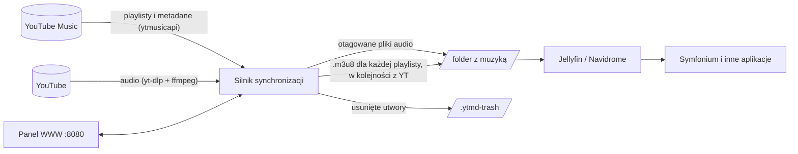

<p align="center"></p>

<p align="center">
  <b>Twoje playlisty z YouTube Music, wiernie odwzorowane w folderze na dysku — automatycznie i na bieżąco.</b><br>
  Mała aplikacja self-hosted z panelem WWW. Działa w Dockerze na wszystkim: od Mac mini po Raspberry Pi.
</p>

<p align="center">
  <a href="https://github.com/RafalPolawski/YT-Music-Downloader/actions/workflows/ci.yml"></a>
  <a href="https://github.com/RafalPolawski/YT-Music-Downloader/pkgs/container/yt-music-downloader"></a>
  <a href="https://github.com/RafalPolawski/YT-Music-Downloader/releases/latest"></a>
  <a href="LICENSE"></a>
</p>

<p align="center">
  <a href="#szybki-start">Szybki start</a> ·
  <a href="#przegląd-aplikacji">Przegląd</a> ·
  <a href="#jellyfin-i-symfonium">Jellyfin i Symfonium</a> ·
  <a href="#konfiguracja">Konfiguracja</a> ·
  <a href="#faq">FAQ</a> ·
  <a href="README.md">🇬🇧 English version</a>
</p>

---

**YT-Music-Downloader** obserwuje Twoją bibliotekę YouTube Music i trzyma lokalną kopię każdej wybranej
playlisty: nowe utwory są pobierane, usunięte — usuwane (przez kosz), a kolejność utworów każdej playlisty
trafia do pliku `.m3u8`. Wystarczy wskazać ten folder w Jellyfinie, Navidrome lub innym serwerze muzyki,
a playlisty pojawią się tam — i w aplikacjach typu **Symfonium** — dokładnie takie, jak w YouTube Music.

**YouTube Music jest źródłem prawdy.** Playlisty układasz tam, gdzie zawsze, a aplikacja pilnuje, żeby
pliki na dysku za tym nadążały.

<p align="center"></p>

## Najważniejsze

<table>
  <tr>
    <td width="33%" valign="top">
      <h3>🔄 Ustaw i zapomnij</h3>
      Co godzinę sprawdza YouTube Music i przenosi dodania, usunięcia oraz zmiany kolejności. Nowe
      playlisty same zaczynają się synchronizować.
    </td>
    <td width="33%" valign="top">
      <h3>📃 Wszędzie ta sama kolejność</h3>
      Jeden <code>.m3u8</code> na playlistę, dokładnie w kolejności z YouTube Music i ze ścieżkami
      względnymi — czytają go Jellyfin, Navidrome, Symfonium, VLC, foobar2000…
    </td>
    <td width="33%" valign="top">
      <h3>🗂️ Playlisty jako foldery</h3>
      <code>Road Trip/Digital Love.opus</code> — tak jak w YouTube Music. Utwór z kilku playlist zajmuje
      miejsce raz (hard link). Wolisz <code>Wykonawca/Album</code>? Jedno kliknięcie.
    </td>
  </tr>
  <tr>
    <td valign="top">
      <h3>🎧 Oryginalna jakość</h3>
      Opus lub M4A prosto z YouTube, bez ponownego kodowania. Wersje albumowe zamiast teledysków, porządne
      tagi, okładki w plikach i zsynchronizowane teksty.
    </td>
    <td valign="top">
      <h3>🛡️ Nic nie przepada</h3>
      Usunięte utwory czekają 30 dni w koszu i wracają od razu, gdy dodasz je ponownie. Podejrzanie duże
      usunięcia czekają na Twoją zgodę.
    </td>
    <td valign="top">
      <h3>🐳 Działa wszędzie</h3>
      Jeden kontener Dockera dla amd64 i arm64 (Apple Silicon, Raspberry Pi). yt-dlp sam się aktualizuje,
      a przerwane synchronizacje są wznawiane.
    </td>
  </tr>
</table>

## Szybki start

Potrzebujesz [Dockera](https://docs.docker.com/get-docker/) (na macOS: Docker Desktop albo [OrbStack](https://orbstack.dev)).

**1. Uruchom kontener**

```bash
mkdir yt-music && cd yt-music
curl -O https://raw.githubusercontent.com/RafalPolawski/YT-Music-Downloader/main/docker-compose.yml
# w docker-compose.yml ustaw folder na muzykę: lewa strona ":/music"
docker compose up -d
```

**2. Otwórz http://localhost:8080** (albo `http://<ip-serwera>:8080` z innego urządzenia) i połącz konto
YouTube Music w **Settings** — kroki są pokazane na miejscu i [opisane niżej](#łączenie-konta).

**3. Wybierz playlisty.** Domyślnie wszystkie są włączone (poza *Liked Music*, która zwykle jest ogromna —
włącz ją, jeśli chcesz). Pierwsza synchronizacja startuje 5 minut po połączeniu konta albo od razu po
kliknięciu **Sync now**.

**4. Wskaż folder serwerowi muzyki** — zobacz [Jellyfin i Symfonium](#jellyfin-i-symfonium).

<details>
<summary>Wolisz zbudować obraz samodzielnie?</summary>

```bash
git clone https://github.com/RafalPolawski/YT-Music-Downloader.git
cd YT-Music-Downloader
# w docker-compose.yml: zakomentuj "image:" i odkomentuj "build: ."
docker compose up -d --build
```
</details>

## Przegląd aplikacji

### Dashboard

Zrzut ekranu na górze: postęp bieżącej synchronizacji z każdym pobieranym utworem, statystyki biblioteki
i lista tego, co się zmieniło — dodane, usunięte, przywrócone, nieudane. **Stop** przerywa bieżącą
synchronizację, a **Pause** dodatkowo wstrzymuje automatyczny harmonogram do wznowienia (*Sync now* nadal
działa).

### Playlisty

Wszystkie playlisty z biblioteki — Twoje i zapisane — z przełącznikiem, czy mają być odwzorowywane. Pasek
pokazuje, ile z danej playlisty jest już na dysku, a filtry wyłapują te, które wymagają uwagi.

<p align="center"></p>

### Utwory

Wyszukiwanie we wszystkim, co jest synchronizowane, filtry po statusie i playliście, powód nieudanego
pobrania i ponawianie. Nieudane pobrania są też ponawiane automatycznie, z rosnącymi odstępami.

<p align="center"></p>

### Duplikaty

Wyszukuje utwory, które są w tej samej playliście dwa razy — ten sam utwór dodany ponownie albo teledysk
obok wersji z albumu. Podpowiada, który zostawić, ale możesz usunąć dowolny wpis: tutaj (w Twoich
playlistach) albo w aplikacji YouTube Music. Nic nie jest usuwane automatycznie.

<p align="center"></p>

### Kosz

Utwory usunięte w YouTube Music najpierw trafiają do ukrytego kosza i są kasowane po 30 dniach. Zmienisz
zdanie? Dodaj utwór z powrotem w YouTube Music, a kolejna synchronizacja go przywróci — bez pobierania.

<p align="center"></p>

### Układ biblioteki

Domyślnie folder odwzorowuje YouTube Music: jeden folder na playlistę. Możesz przełączyć na klasyczną
bibliotekę `Wykonawca/Album/01 Tytuł` (najlepsze widoki albumów i wykonawców w Jellyfinie, Navidrome
i Plexie), `Wykonawca/Tytuł` albo jeden płaski folder — zapisanie od razu przebudowuje istniejące pliki,
nic nie jest pobierane ponownie.

<p align="center"></p>

### Na telefonie, w ciemnym i jasnym motywie

Cały panel działa na telefonie, więc wszystko sprawdzisz z kanapy. Motyw ciemny i jasny podąża za
systemem albo za przełącznikiem w pasku bocznym.

<p align="center"></p>
<p align="center"></p>

## Łączenie konta

Wejdź w **Settings → Connect YouTube Music** i wykonaj pokazane tam kroki:

1. Otwórz [music.youtube.com](https://music.youtube.com) w przeglądarce na komputerze i zaloguj się.
   *Wskazówka: użyj okna prywatnego i po prostu je zamknij — wylogowanie unieważniłoby skopiowaną sesję.*
2. Otwórz narzędzia deweloperskie (`F12` / `⌥⌘I`) → zakładka **Network** → wpisz `browse` w filtrze.
3. Kliknij **Biblioteka** w YouTube Music, żeby pojawiło się żądanie `browse` (POST).
4. Prawy klik → **Copy → Copy request headers** (Firefox: *Copy Request Headers*; działa też *Copy as cURL*).
5. Wklej do pola i kliknij **Connect**.

<p align="center"></p>

Sesja pozostaje ważna długo (zwykle miesiące, nawet lata), dopóki się z niej nie wylogujesz. Jeśli
kiedyś wygaśnie, dashboard to pokaże — wtedy wystarczy wkleić świeże nagłówki.

> Przechodzisz ze starej wersji skryptu? Możesz wkleić zawartość starego pliku `headers.json`.

<details>
<summary>Alternatywa: „Sign in with Google” (kod urządzenia OAuth)</summary>

Zakładka **Sign in with Google** działa jak logowanie na telewizorze: aplikacja pokazuje kod, a Ty
potwierdzasz go na [google.com/device](https://www.google.com/device) na dowolnym urządzeniu. Google
pozwala na to tylko z własnym klientem OAuth — to jednorazowa, darmowa konfiguracja:

1. W [Google Cloud Console](https://console.cloud.google.com/) utwórz projekt i włącz **YouTube Data API v3**.
2. **APIs & Services → OAuth consent screen**: typ użytkownika *External*, dodaj swoje konto Google jako **test user**.
3. **Credentials → Create credentials → OAuth client ID**, typ **TVs and Limited Input devices**.
4. Wklej client ID i secret w aplikacji, kliknij **Get sign-in code** i potwierdź kod.

Zalecaną metodą pozostaje sesja z przeglądarki: nie wymaga projektu w Google Cloud, jest najbardziej
niezawodna z YouTube Music i tylko z nią działa *Download as signed-in user*.
</details>

## Jak to działa



Każda synchronizacja:

1. Czyta playlisty z Twojej biblioteki i utwory każdej włączonej playlisty.
2. Przenosi do kosza pliki, których nie ma już w **żadnej** synchronizowanej playliście, przywraca te,
   które wróciły, oraz przenosi/zmienia nazwy plików, gdy zmieniły się metadane albo układ folderów.
3. Pobiera brakujące utwory, taguje je, dodaje okładki i teksty.
4. Zapisuje po jednym `.m3u8` na playlistę, czyści z kosza stare pliki i (opcjonalnie) prosi Jellyfina
   o przeskanowanie biblioteki.

## Co ląduje na dysku

```text
music/
├── Road Trip/                         ← jeden folder na playlistę (domyślny układ)
│   ├── cover.jpg                      ← wygenerowana okładka playlisty
│   ├── Digital Love.opus
│   ├── Digital Love.lrc               ← zsynchronizowany tekst (jeśli jest)
│   └── Kong.opus
├── Deep Focus/
│   └── Kong.opus                      ← ten sam utwór w dwóch playlistach: hard link, bez dodatkowego miejsca
├── Playlists/
│   ├── Road Trip.m3u8                 ← kolejność dokładnie jak w YouTube Music
│   └── Deep Focus.m3u8
├── .ytmd-trash/                       ← ukryty: usunięte utwory, kasowane po 30 dniach
└── .ytmd-tmp/                         ← ukryty: pobierania w toku
```

Nazwa pliku to sam tytuł; jeśli dwa różne utwory w jednej playliście mają ten sam tytuł, dopisywany jest
wykonawca (`Kong (Bonobo).opus`). Plik playlisty wygląda tak — ścieżki są względne, więc działa niezależnie
od tego, gdzie folder jest zamontowany:

```text
#EXTM3U
#PLAYLIST:Road Trip
#EXTINF:301,Daft Punk - Digital Love
../Road Trip/Digital Love.opus
#EXTINF:244,Bonobo - Kong
../Road Trip/Kong.opus
```

Hard linki wymagają, żeby folder z muzyką był na jednym dysku; tam, gdzie nie są obsługiwane (niektóre
udziały sieciowe), robiona jest zwykła kopia.

## Jellyfin i Symfonium

1. W Jellyfinie: **Dashboard → Libraries → Add Media Library**, typ zawartości **Music**, folder = Twój
   folder z muzyką. Jeśli Jellyfin działa w Dockerze, zamontuj do niego ten sam folder z hosta (ścieżka
   w kontenerze nie ma znaczenia dzięki ścieżkom względnym w playlistach).
2. Jellyfin importuje pliki `.m3u8` z folderu `Playlists/` jako playlisty, w kolejności z YouTube Music.
   Pojawiają się po skanowaniu biblioteki.
3. Jellyfin skanuje biblioteki według własnego harmonogramu (**Dashboard → Scheduled Tasks → Scan Media
   Library** — dodaj np. wyzwalacz co godzinę, jeśli zmiany mają pojawiać się szybciej). Opcjonalnie wpisz
   adres Jellyfina i klucz API w **Settings → Jellyfin** — wtedy skan uruchomi się zaraz po każdej
   synchronizacji, która coś zmieniła.
4. W **Symfonium** dodaj serwer Jellyfin jako źródło (media provider). Playlisty i nowe utwory pojawią się
   po kolejnej synchronizacji źródła.

**Okładki w układzie playlist:** Jellyfin traktuje każdy folder jako jeden album, więc utwory z folderu
playlisty dostają wspólny obrazek albumu — stąd wrażenie „złych” okładek przy niektórych utworach. Żeby to
było celowe, aplikacja wrzuca do każdego folderu playlisty wygenerowany `cover.jpg` z nazwą playlisty
(Settings → *Folder covers*):

<p align="center"></p>

Prawdziwa okładka każdego utworu zostaje osadzona w pliku; jeśli chcesz, żeby Jellyfin i Symfonium wszędzie
pokazywały okładki albumów, użyj układu `Artist/Album/Track`.

**Navidrome** działa tak samo — automatycznie importuje playlisty `.m3u8` z folderu z muzyką.

## Mac mini (Apple Silicon) 24/7

- Zainstaluj **OrbStack** (lekki, polecany) albo **Docker Desktop** i włącz *uruchamianie przy logowaniu*.
  Obraz jest natywnie arm64, bez emulacji.
- Podaj pełną ścieżkę do folderu z muzyką, np.
  ```yaml
  volumes:
    - ./config:/config
    - "/Users/ty/Music/YouTube Music:/music"
  ```
  Dyski zewnętrzne są pod `/Volumes/...`; w Docker Desktop dodaj je w *Settings → Resources → File
  sharing* (OrbStack udostępnia wszystko domyślnie).
- `PUID`/`PGID` na macOS mogą zostać domyślne — pliki i tak należą do Twojego użytkownika.
- *Ustawienia systemowe → Energia*: włącz **Zapobiegaj automatycznemu usypianiu, gdy ekran jest
  wyłączony** oraz **Uruchamiaj automatycznie po awarii zasilania**.
- `restart: unless-stopped` w pliku compose podnosi aplikację po restarcie komputera.

Na serwerze z Linuksem ustaw `PUID`/`PGID` na właściciela folderu z muzyką (`id -u` / `id -g`).

## Konfiguracja

Prawie wszystko ustawia się w panelu WWW; zapisuje się to w `config/settings.json`.

| Ustawienie | Domyślnie | Co robi |
| --- | --- | --- |
| Check YouTube Music | co godzinę | Jak często playlisty są porównywane z YouTube Music. |
| Sync new playlists automatically | wł. | Nowe playlisty w bibliotece same zaczynają się synchronizować. |
| Format | Opus | `opus` / `m4a` (oryginalne strumienie) lub `mp3` (przekodowane V0). |
| Prefer album versions | wł. | Pobiera utwór z albumu zamiast teledysku. |
| Lyrics / Folder covers | wł. | Tekst w pliku + `.lrc`, `cover.jpg` w folderze albumu lub playlisty. |
| Folder layout | Playlist/Track | Albo `Artist/Album/Track`, `Artist/Track` lub jeden płaski folder. |
| Playlist files folder | `Playlists` | Gdzie trafiają pliki `.m3u8` (wewnątrz folderu z muzyką). |
| Keep removed tracks for | 30 dni | `0` = usuwanie od razu. |
| Safety net | 50 % / 10 utworów | Wstrzymuje usuwanie, gdy playlista nagle tyle straci. |
| Parallel downloads / pause | 2 / 3 s | Delikatnie — YouTube limituje agresywne pobieranie. |
| Download as signed-in user | wył. | Potrzebne dla utworów 18+ i strumieni Premium 256 kb/s. |
| Jellyfin URL + API key | – | Opcjonalnie: skan biblioteki po każdej synchronizacji. |

Zmienne środowiskowe (poziom kontenera):

| Zmienna | Domyślnie | Opis |
| --- | --- | --- |
| `PUID` / `PGID` | `1000` | Użytkownik/grupa, jako które działa aplikacja i do których należą pliki. |
| `TZ` | `Etc/UTC` | Strefa czasowa logów i panelu, np. `Europe/Warsaw`. |
| `YTMD_WEB_PASSWORD` | – | Zabezpiecza panel hasłem (HTTP basic auth, użytkownik `admin`). |
| `YTMD_WEB_USER` | `admin` | Nazwa użytkownika do hasła powyżej. |
| `YTMD_PORT` | `8080` | Port wewnątrz kontenera. |
| `YTMD_MUSIC_DIR` / `YTMD_CONFIG_DIR` | `/music` / `/config` | Ścieżki wewnątrz kontenera. |
| `YTMD_LOG_LEVEL` | `INFO` | `DEBUG` dla bardzo szczegółowych logów. |

Folder `config` zawiera `browser.json` — Twoją sesję YouTube Music. **Traktuj go jak hasło** i nie
wystawiaj portu 8080 do internetu (do zdalnego dostępu użyj VPN, np. Tailscale).

## Usuwanie, kosz i bezpieczniki

- Usunięcie utworu z playlisty w YouTube Music usuwa go z folderu tej playlisty. Sam pobrany plik trafia
  do kosza dopiero wtedy, gdy utworu nie ma już w żadnej synchronizowanej playliście.
- Usunięte pliki trafiają do `.ytmd-trash/` (ukryty przed serwerami multimediów) i są kasowane po okresie
  przechowywania. Strona **Trash** pokazuje je; możesz usunąć je od razu albo opróżnić kosz.
- Jeśli utwór wróci na playlistę, zostanie przywrócony z kosza zamiast pobierany ponownie.
- **Wyłączenie** playlisty w panelu usuwa jej `.m3u8` i utwory, które były tylko w niej (do kosza).
- **Bezpieczniki:** gdy playlista straci naraz ≥ 50 % utworów (i więcej niż 10) albo kilka playlist
  jednocześnie zniknie z biblioteki, nic nie jest usuwane, dopóki nie klikniesz **Approve** — to chroni
  przed chwilowymi błędami po stronie YouTube.

## FAQ

**Czy potrzebuję YouTube Music Premium?**
Nie, wystarczy darmowe konto. Z Premium i włączonym *Download as signed-in user* używane są strumienie
256 kb/s, jeśli są dostępne.

**Czy aplikacja zna moje hasło do Google?**
Nie. Trzyma wklejoną sesję przeglądarki (albo token OAuth) w `config/` na Twoim komputerze i używa jej
tylko do zapytań do YouTube.

**Czy potrzebuję Jellyfina?**
Nie. Wynikiem jest zwykły folder z otagowanymi plikami audio i playlistami `.m3u8` — użyjesz go z dowolnym
odtwarzaczem lub serwerem muzyki albo skopiujesz na telefon.

**Co się stanie, gdy zmienię nazwę playlisty albo ją usunę w YouTube Music?**
Po zmianie nazwy folder i plik `.m3u8` zmienią nazwę przy kolejnej synchronizacji. Usunięta playlista
znika z folderu, a jej utwory trafiają do kosza, chyba że są jeszcze w innej synchronizowanej playliście.

**Czy YouTube nie będzie miał nic przeciwko?**
Sprawdzenie to kilka lekkich zapytań na playlistę raz na godzinę, a pobieranie odbywa się tylko wtedy, gdy
coś się zmieniło. Idą po dwa naraz z przerwą pomiędzy, a gdy YouTube zaczyna limitować, aplikacja sama
zwalnia.

## Rozwiązywanie problemów

| Objaw | Rozwiązanie |
| --- | --- |
| *„Sign in to confirm you're not a bot”*, HTTP 429 | YouTube limituje Twoje IP. Aplikacja sama wstrzymuje pobieranie (1 h, potem dłużej) i sama wznawia. Zmniejsz *Parallel downloads* albo zwiększ przerwę. |
| Utwory 18+ / tylko dla Premium się nie pobierają | Włącz *Download as signed-in user* albo wgraj `cookies.txt` (Settings → Downloads). |
| „Sign-in expired” na dashboardzie | Wklej świeże nagłówki w ustawieniach (pewnie sesja w tej przeglądarce została wylogowana). |
| Komunikat „music folder is not writable” | Ustaw `PUID`/`PGID` na właściciela folderu. |
| Utwór ma status *Unavailable* | Jest wyszarzony w YouTube Music (usunięty lub zablokowany regionalnie) — jest pomijany. |
| Nagle wiele pobrań kończy się błędem | Zwykle nieaktualny yt-dlp; aktualizuje się codziennie, możesz też kliknąć *Update now* w Settings → Advanced. |

Logi: strona **Logs**, `docker compose logs -f` albo `config/logs/ytmd.log`.

## Aktualizacja

```bash
docker compose pull && docker compose up -d
```

Ustawienia, połączenie z kontem i stan synchronizacji są w `config/`, więc aktualizacja jest
bezpieczna. Tagi obrazu: `latest` to najnowsze wydanie, `1` zostaje na wydaniach 1.x, `1.2.0`
przypina konkretną wersję, a `edge` śledzi gałąź `main`. Zmiany w kolejnych wersjach opisuje
[changelog](CHANGELOG.md) i [strona wydań](https://github.com/RafalPolawski/YT-Music-Downloader/releases).

## Bez Dockera

Wymaga Pythona 3.11+, `ffmpeg` oraz (zalecane) [`deno`](https://deno.com) w `PATH`.

```bash
python -m venv .venv && source .venv/bin/activate
pip install -r requirements.txt
YTMD_CONFIG_DIR=./data/config YTMD_MUSIC_DIR=./data/music python -m ytmd
```

## Rozwój

```bash
pip install -r requirements-dev.txt
python -m pytest
```

Opis struktury kodu i wydawania wersji znajdziesz w [angielskim README](README.md#development).

## Zastrzeżenie

Projekt służy do prywatnych kopii muzyki, do której masz dostęp. Przestrzegaj regulaminu YouTube i prawa
autorskiego obowiązującego w Twoim kraju. Projekt nie jest powiązany z YouTube ani Google.
Playlisty, wykonawcy i okładki na zrzutach ekranu są zmyślone.

## Licencja

[MIT](LICENSE)
